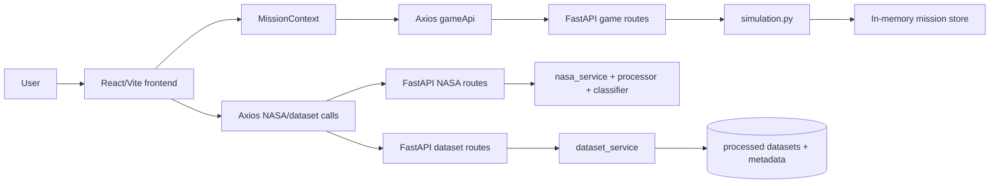
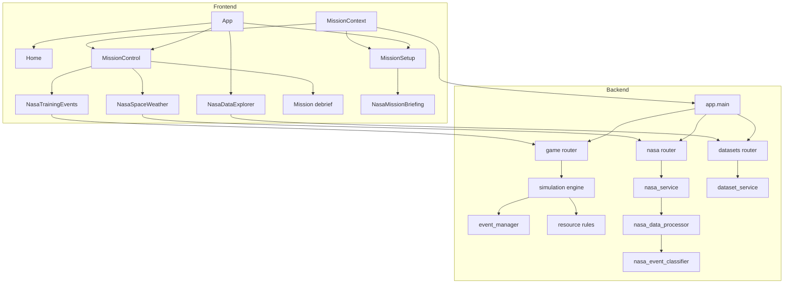
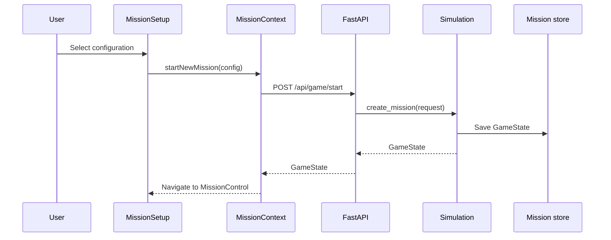
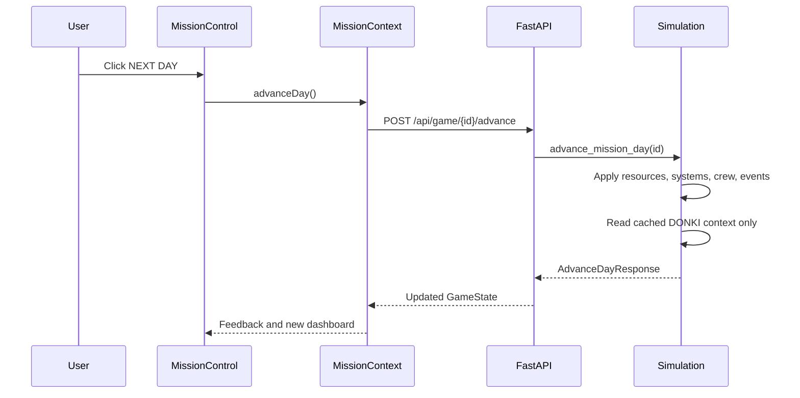
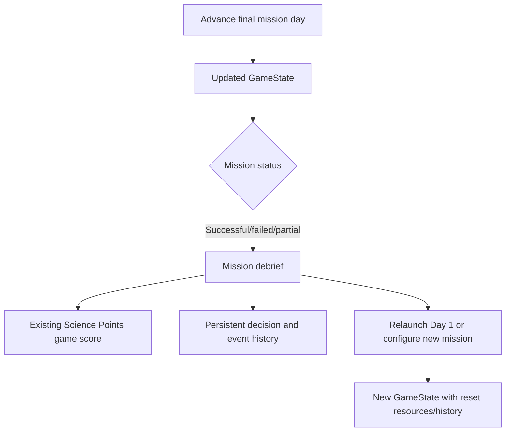

# System Architecture

## Overview

The frontend is a React/Vite single-page application. `MissionProvider` owns
the current mission ID, setup preferences, authoritative backend state,
loading/error state, actions, and replay operations. FastAPI is the authority
for simulation state and exposes separate game, DONKI, and static-dataset
routers.

## High-level architecture



## Component diagram



## Mission initialization sequence



## Daily progression sequence



## NASA data integration flow

```mermaid
flowchart LR
  Env[NASA_API_KEY + cache settings] --> Service[nasa_service]
  Service --> NASA[api.nasa.gov/DONKI]
  Service --> Fallback[CCMC DONKI fallback]
  Service --> Cache[In-memory cached snapshot]
  Cache --> Processor[nasa_data_processor]
  Processor --> Classifier[nasa_event_classifier]
  Classifier --> Routes[/api/nasa/*]
  Routes --> Panel[NASA Space Weather]
  Cache --> Simulation
  Catalog[dataset_catalog.csv] --> DatasetService[dataset_service]
  Processed[datasets/processed] --> DatasetService
  DatasetService --> DatasetRoutes[/api/datasets/*]
  DatasetRoutes --> Explorer[NASA Data Explorer]
  DatasetRoutes --> Briefing[Mission Briefing]
```

## Mission completion flow



## State and scientific boundaries

Resources, events, decisions, `mission_decisions`, `mission_events`, and
training events are stored in the Pydantic `GameState` and returned by the
backend. NASA values are contextual inputs only. They are never converted into
astronaut dose, habitat temperature, landing safety, network delay, or resource
amounts.
